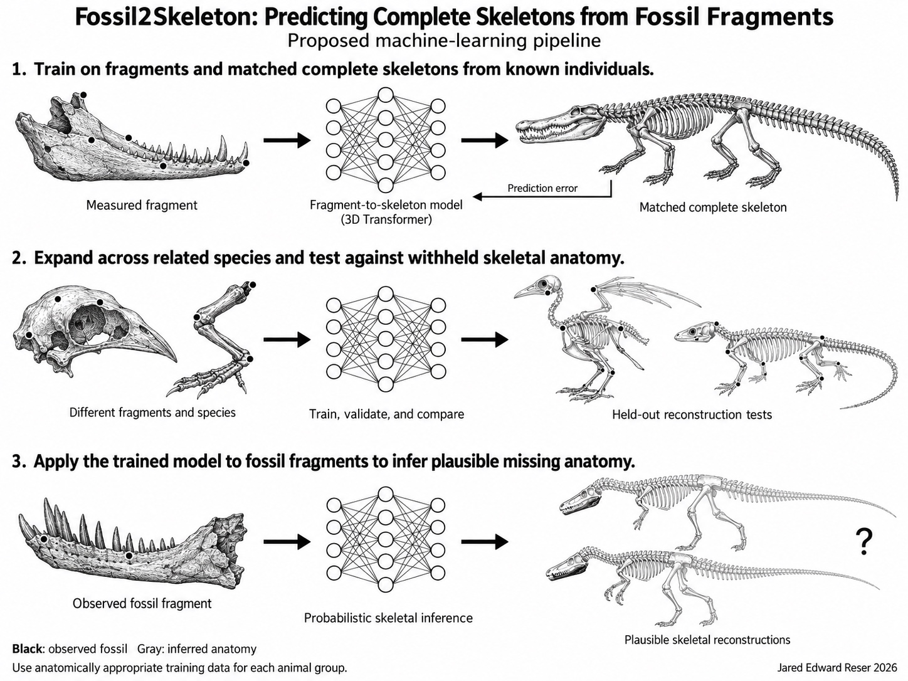

# Fossil2Skeleton: Probabilistic Reconstruction of Complete Skeletal Anatomy from Fossil Fragments

**Jared Edward Reser, Ph.D.**  
October 21, 2026

Published source: https://iteratedinsights.com/2026/10/21/fossil2skeleton/

> **Editorial note (October 22, 2026):** This is a text transcription of the published article. Whitespace has been normalized and the supplied pipeline figure has been placed below. The published HTML omits several variable symbols and displayed equations in “The reconstruction problem,” “Interrogating predictions and choosing the next observation,” and “Technical appendix.” Those omissions are preserved in the text below. Consult the original manuscript if exact formulas become available; none have been inferred for this copy.

## Abstract

An incomplete fossil preserves only part of an animal, but its surviving anatomy may contain statistical information about skeletal regions that have been lost. I propose Fossil2Skeleton, a machine learning framework for estimating distributions of complete skeletal anatomy from variable combinations of fossil fragments. The system would learn from associated skeletal material across individuals and species, using geometric representations, masked anatomical prediction, and conditional generative modeling. A fragment encoder would represent the preserved evidence, while a generative model would produce coordinated hypotheses about missing bones, their proportions, and their relationships. Training would progress from anatomical representation learning to prediction of withheld anatomy and then to evaluation under fossil preservation and evolutionary differences. The framework would support quantitative reconstruction, interpretation of which features drive predictions, estimation of the value of additional evidence, and propagation of anatomical uncertainty into downstream analyses. Its central empirical question is whether detailed fragment morphology predicts missing anatomy beyond what can already be inferred from size and evolutionary relatedness. This article specifies the proposed framework, a feasible transformer and diffusion implementation, and an experimental program for testing it. Applications include incomplete dinosaur skeletons and extinct mammals such as Gigantopithecus. Fossil2Skeleton would make the recoverable information in fragmentary remains a measurable object of scientific investigation.

*Keywords: fossil reconstruction; geometric morphometrics; machine learning; skeletal integration; conditional generation; paleontology; uncertainty*

*Figure: Proposed fragment-to-skeleton learning and evaluation pipeline, Jared Edward Reser (2026).*

## The information preserved in a fragment

A fossil jaw is a physical remnant of an animal whose other bones were produced by the same developing organism. Those bones shared a growth history, inherited developmental machinery, and the mechanical requirements of supporting and moving one body. These relationships create a basis for asking whether measurements of the jaw can constrain the shape of the missing skull, limbs, vertebral column, or pelvis. The strength of each relationship must be measured, and it will differ across anatomical regions and evolutionary groups.

Paleontologists already use comparative anatomy and morphometrics to reconstruct missing structures. Virtual reconstruction has formalized the use of symmetry, geometric relationships, and comparative variation in damaged fossils (Gunz et al., 2009). Fossil2Skeleton would extend this scientific task into a general learning problem: given a variable subset of preserved anatomy, infer the distribution of skeletal configurations compatible with it. The proposed system would learn relationships across separate bones and across scales, from local surface geometry to overall skeletal proportions.

The motivating example is straightforward. If many primates have documented jaws and associated skeletons, a model can be trained on their relationships. After withholding the rest of an animal, researchers can supply its jaw and measure how accurately the model predicts the omitted anatomy. The same principle applies to a femur, a vertebral fragment, a partial skull, or a combination of remains. The identity and completeness of the input can vary while the learning objective remains conditional anatomical reconstruction.

I introduce Fossil2Skeleton here as a general framework for this task. Its proposed contributions are whole-skeleton inference from variable fragment combinations, joint prediction of coordinated anatomy, empirical evaluation across evolutionary boundaries, and interrogation of the information contributed by individual observations. This article presents a research proposal and implementation plan; it reports no trained Fossil2Skeleton model or experimental results.

## The reconstruction problem

Let denote skeletal anatomy, the observed fossil geometry, a record of which regions are observed, and independently available context. Context may include evolutionary relationships, geological age, and developmental information when these are documented. The target is a learned conditional distribution:

The parameters are learned from reference data. The distribution represents alternatives under the model and its assumptions. A single completed skeleton would be one sample from that distribution. The preserved anatomy should constrain every sample within its measurement and preservation uncertainty, while unresolved regions can vary.

This must be a joint distribution. Predicting every missing bone independently could combine individually plausible parts into an inconsistent skeleton. Sampling the pelvis, femur, and tibia together allows their dimensions and joint relationships to covary. Averaging incompatible alternatives could likewise create a shape that resembles none of the supported configurations. The system should retain distinct alternatives and summarize the dimensions or relationships that vary among them.

Three tasks should be evaluated separately. The first completes an individual from a species represented by many other specimens. The second predicts withheld anatomy from a species excluded from training. The third extrapolates to a fossil lineage with unusual proportions or no close anatomical analogues in the reference data. These tasks demand progressively stronger generalization. Their error rates and uncertainty calibration should be reported separately.

Fossil preservation introduces a second inference problem. Observed geometry may differ from original anatomy because of crushing, breakage, erosion, or imperfect scanning. A useful observation model is:

Here, represents deformation, selects the preserved and measured portions, and represents measurement error. The system can estimate anatomy while considering alternative deformation parameters, rather than treating every distorted surface as an accurate record of the living animal. The allowed deformations must be constrained by preservation evidence so they cannot simply erase inconvenient anatomy.

## Representing bones and skeletons numerically

The fragment and the target skeleton would both be converted into numerical representations. A useful hierarchy begins with surface patches from three-dimensional scans. A local encoder maps these patches into vectors containing information about curvature, dimensions, and spatial relationships. A higher-level encoder integrates the patches into representations of bones or fragments. A skeletal model then relates those representations across the body.

The input should include physical scale, scan quality, anatomical labels when known, and uncertainty about those labels. Shape can be normalized for particular computations, but the original dimensions must remain accessible. Scaling a fragment by the length of the hidden complete skeleton would leak the answer into the input. Likewise, the arbitrary arrangement of disarticulated bones on a scanning table must be distinguished from their anatomical arrangement.

The output would combine bone shapes with their dimensions, identities, and relationships in a standardized articulation. Surface geometry and articulation can be represented separately so that an uncertain pose does not become confused with uncertainty about the shape of a bone. Rotation-aware geometric processing could reduce dependence on scanner orientation; equivariant graph networks provide one established computational approach to this problem (Satorras et al., 2021).

The representation must distinguish unobserved anatomy from anatomical absence. A bone that was not scanned, a bone lost during fossilization, and a bone absent from the animal require different states. Fusion and variation in vertebral number also require explicit treatment. An initial model can use a documented inventory of homologous elements within one group. A broader system would need to model alternative bone counts, identities, and connections rather than forcing every animal into one fixed template.

## A three stage learning program

For Fossil2Skeleton, I propose three operational stages. These carry forward the broader strategy of learning from known biological systems before applying the model to extinct animals, while addressing a different mapping from my earlier skeleton-to-genome proposal (Reser, 2025).

In the first stage, an encoder and decoder would learn compact representations of bones and skeletal regions. Large collections of isolated bones could contribute to this stage because the task is to learn geometry. Masking parts of measured bones would provide an additional training objective: the system must infer withheld patches from the observed remainder. Point-MAE demonstrates this form of self-supervised representation learning for point clouds (Pang et al., 2022).

In the second stage, the model would learn relationships among bones from associated specimens. Each training example would expose a subset of an individual’s anatomy and use withheld, measured anatomy as the target. Across training, the visible subset would vary from nearly complete skeletons to single bones and small fragments. Masks should approximate realistic preservation patterns, including correlated loss of neighboring structures, instead of relying exclusively on uniformly random deletions.

The third stage would establish when the learned relationships transfer to fossil conditions. Training augmentation could introduce controlled deformation, erosion, incomplete surfaces, and scan noise. Evaluation would use untouched test specimens and fossil material with independently documented targets. Applying the system to an unknown fossil would normally use fixed model weights. Repeatedly adjusting a generated skeleton to match that fossil is an inference procedure, not supervised learning from its unknown original skeleton.

This organization allows broad geometric learning while retaining explicit tests of biological transfer. A shared model could learn from many vertebrate groups, with contextual conditioning where justified. Whether additional distant taxa improve a particular task is an empirical question. Learning curves should compare restricted and expanded datasets while controlling for sample size, so any benefit of taxonomic diversity can be distinguished from the benefit of simply having more observations.

## A transformer and diffusion implementation

A feasible implementation would combine a fragment encoder, a transformer operating on skeletal representations, and a geometry decoder. PoinTr establishes a precedent for transformer-based completion of three-dimensional point clouds (Yu et al., 2021). In Fossil2Skeleton, observed-fragment tokens would provide the conditioning evidence. Candidate-bone tokens would represent the developing anatomical reconstruction.

Cross-attention would allow each candidate bone to use information from the preserved fragments. Attention among candidate bones would allow their predictions to depend on one another. During training, errors against actual associated anatomy would adjust these interactions. The model could therefore learn, for example, whether particular combinations of femoral geometry and pelvic dimensions are informative within a group. Attention weights alone would not establish which biological relationship had been learned; that requires controlled evaluation.

Conditional diffusion provides one way to implement iterative generation. Diffusion has already been applied to probabilistic three-dimensional shape completion, producing multiple completions for the same partial observation (Zhou et al., 2021). Operating in a learned latent representation could reduce the cost of modeling full surfaces, following the general computational strategy demonstrated by latent diffusion models (Rombach et al., 2022). The proposed skeletal application would require its own architecture, data, and validation.

During training, a documented target skeleton is encoded as a collection of latent vectors. Noise is added at a selected intensity, and the transformer learns to predict that noise while receiving the preserved fragment as context. The known noise provides a direct learning signal. Additional geometry losses can check reconstructed dimensions, observed-surface agreement, and joint compatibility. These losses should be balanced across bones so densely sampled surfaces do not dominate smaller but informative structures.

At inference, the process begins with random latent values. The trained model progressively removes noise while conditioning on the fossil evidence. The decoder turns the resulting vectors into skeletal geometry. Repeating the procedure produces alternative reconstructions. Direct observation consistency must be checked in geometry space because agreement between latent vectors does not guarantee that the generated surface matches the fossil.

Supervised and self-supervised learning provide the main training signals. Reinforcement learning is an optional later extension if a useful reward cannot be expressed through the standard objectives. It is not necessary to create the iterative reconstruction process, and a reward for visual plausibility would be insufficient evidence of anatomical accuracy.

## Building a dataset that can support the inference

The most consequential data requirement is association. Isolated jaws teach a model about jaws; isolated femora teach it about femora. Learning how jaw variation covaries with femoral variation requires specimens that preserve both, or a carefully connected collection of overlapping observations with additional assumptions. Neither geometric pretraining nor repeated masking can replace biological associations that the dataset never records.

Three-dimensional collections such as the openVertebrate project offer a foundation for assembling comparative material (Blackburn et al., 2024). The resulting dataset would still require curation of specimen identity, taxonomic assignment, maturity, preservation, segmentation, and measurement units. Human and commonly scanned model organisms should not overwhelm smaller reference groups simply because their scans are abundant. Sampling strategies and reported performance should make that imbalance visible.

Incomplete specimens can contribute without inventing targets. If an individual preserves a jaw, pelvis, and femur, one of those elements can be hidden and predicted from the others. Loss is evaluated only where a measured target exists. Fossil mounts and digital reconstructions require special attention: original fossil, mirrored material, comparative substitutions, and artist-generated regions must remain distinguishable. Reconstructed anatomy cannot silently become ground truth.

Within-species and between-species variation should be modeled and evaluated separately. If every species contributes one composite skeleton, the model cannot learn individual variation reliably. If every test individual belongs to a familiar species, performance may mostly reflect recognition of a species template. Multiple individuals per species and tests excluding whole species are therefore complementary requirements.

## Testing anatomical information and uncertainty

The first empirical target should be deliberately tractable: predict measured dimensions and landmarks of withheld skeletal regions from jaw geometry in a documented comparative group. This tests the anatomical premise before requiring detailed surface generation. The full generative model can then be evaluated on the same biological partitions, preventing improvements in rendering quality from being confused with improvements in inference.

The main comparisons should include size-based regression, a nearest-relative reconstruction, a statistical shape model, and a model supplied with size and evolutionary context but no detailed fragment shape. An additional control can shuffle the pairing between fragments and target skeletons within appropriate size and taxonomic strata. If the detailed model performs similarly after meaningful associations are broken, its apparent success needs a different explanation.

Dataset partitions should exclude entire individuals, species, and larger evolutionary groups in separate experiments. Duplicate scans, casts, reconstructed versions, and all masks of one specimen must remain in the same partition. Preprocessing, template construction, representation learning, and hyperparameter selection must respect the intended exclusion. A purported unseen-species test is compromised if its complete skeleton entered pretraining.

Evaluation should report errors in dimensions, landmarks, surfaces, and articulation, alongside the uncertainty assigned to them. A nominal 90 percent prediction interval should contain the measured target approximately 90 percent of the time across comparable test cases. Coverage should be considered together with interval width, because extremely broad intervals can be accurate without being useful. Joint anatomical plausibility also requires evaluation beyond separate intervals for individual measurements.

Uncertainty has several sources: incomplete observations, natural variation among compatible animals, measurement and preservation error, and insufficient knowledge about the target lineage. Multiple samples from one generative model mainly express uncertainty represented within that model. They do not automatically reveal errors shared by all its predictions. Comparisons among independently trained models, alternative reference sets, and competing evolutionary assumptions can expose additional sensitivity, although they cannot guarantee reliable extrapolation to every extinct form.

Three outcomes would provide meaningful support for the framework. Detailed fragment geometry would improve prediction beyond size and relatedness; the improvement would persist under species exclusion; and predicted uncertainty would remain informative under progressively more severe preservation loss. A failure to predict a particular region would also be scientifically useful if it identifies where the available fragment contributes little information.

## Interrogating predictions and choosing the next observation

Fossil2Skeleton should expose how its predictions depend on evidence. Researchers could remove a region of the input, compare alternative scans, or make a biologically plausible change to a measured feature while monitoring the output distribution. Comparing naturally occurring specimens matched for size and relatedness would provide another test. These procedures measure model dependence. Establishing developmental causation would require additional biological evidence.

One useful output would be an anatomical information map: a record of which observed regions improve predictions of which missing regions, and by how much on held-out specimens. Such a map could reveal strong local relationships, weak long-distance relationships, or combinations of fragments whose joint value exceeds their separate contributions. The map would be learned and tested for particular groups rather than assumed to apply universally.

The same framework could rank prospective observations. Let be a target anatomical quantity, such as pelvic breadth, and a possible measurement of another bone. The expected information gain from obtaining that measurement is:

Here, measures uncertainty in the target, with the observation record understood as part of . This compares present uncertainty with the uncertainty expected after collecting additional evidence. It could help prioritize preparation of fossil blocks, examination of associated museum material, or scanning of particular surfaces. The calculation ranks information value under the model; it does not predict where undiscovered fossils will be found. Its usefulness should itself be tested by withholding candidate observations and measuring the improvements obtained when they are restored.

## Applications to dinosaurs and extinct mammals

Incomplete dinosaurs provide a direct application. A specimen preserving portions of the pelvis, vertebrae, and limbs could condition an ensemble of complete skeletal hypotheses. These hypotheses could be used to examine how uncertainty in bone proportions affects downstream estimates of posture, balance, or locomotion. Dinosaur mass modeling already uses sensitivity analyses to examine the consequences of alternative reconstructions (Bates et al., 2009). Fossil2Skeleton would provide a learned source of anatomical alternatives while leaving soft-tissue and functional assumptions explicit.

Historical discovery sequences offer unusually informative tests. Deinocheirus was known largely from enormous forelimbs and shoulder elements for almost five decades before additional specimens revealed much more of its unusual anatomy (Lee et al., 2014). A reconstruction model could be denied the later anatomical evidence, given only the original material, and evaluated against subsequently documented features. Such a test would require auditing training inputs to exclude later reconstructions and descriptions that could reveal the answer. Differences in size among the actual individuals would also need to be modeled.

Gigantopithecus illustrates a more extreme application. Its known jaws and teeth constrain some anatomy directly while leaving its postcranial skeleton unresolved. Enamel proteins provide independent evidence linking it to the orangutan lineage (Welker et al., 2019). A model trained on associated primate skeletons could compare predictions based on jaw geometry alone with those incorporating that evolutionary context. The resulting alternatives would be hypotheses about missing anatomy. Their most useful contribution might be identifying which body dimensions are weakly constrained even after all available evidence is considered.

Other applications include reconstruction of incomplete archaeological animal remains, comparison of possible skeletal associations, and reproducible museum displays. A poor fit among bones could flag a mixed assemblage, deformation, or unusual anatomy; it would not identify the cause by itself. With suitably documented developmental series, the framework could also examine how predictive relationships change with age. These applications would require training and evaluation matched to their populations and preservation conditions.

## Relation to other reconstruction systems

Fossil2Skeleton complements my earlier proposal to learn mappings between skeletal morphology and genomic information (Reser, 2025). It addresses an upstream problem: the anatomical input to such a system is often incomplete. Instead of selecting one reconstruction and treating it as known, downstream analyses could evaluate a distribution of candidate skeletons and carry that uncertainty forward.

Generated anatomy must remain dependent on the fossil evidence and reference model that produced it. Passing a predicted bone into Skeleton2DNA would not create an additional independent observation about an extinct genome. A coherent combined model would integrate over uncertain anatomy and distinguish morphological constraints from direct molecular evidence. Comparable principles would apply to proposed Endocast2Brain and Skull2Face systems, each of which would require separate training data and validation.

## Related work and the scope of the proposal

The computational components have established precedents. Gunz et al. (2009) formalized virtual reconstruction of incomplete and distorted crania. PoinTr uses transformers for point-cloud completion (Yu et al., 2021), Point-MAE learns representations through masked geometric prediction (Pang et al., 2022), and point-voxel diffusion supports probabilistic shape completion (Zhou et al., 2021). These studies establish relevant methods without demonstrating the complete Fossil2Skeleton program.

Closer anatomical work includes statistical reconstruction of missing pelvic regions using human and great-ape reference specimens (Torres-Tamayo et al., 2025). An active project described by Wolcott (2026) applies generative neural shape models to fragmented fossil vertebrae and related classification tasks; its listed manuscripts are in preparation. These approaches overlap with parts of the present proposal and should be acknowledged at that scope.

Fossil2Skeleton is formulated here around the integrated task of inferring whole skeletal configurations from variable preserved subsets, learning relationships across separate bones, testing transfer across evolutionary groups, and measuring both evidential dependence and the prospective value of additional observations. The proposed contribution is this research framework and its testable implementation. It does not depend on claiming invention of its individual computational ingredients.

## An experimental path forward

The first implementation should assemble a curated set of associated skeletons and test jaw-to-skeleton prediction at the level of landmarks and dimensions. The next should add alternative input bones, realistic fragment masks, and calibrated generative outputs. Broader taxonomic training and detailed surface reconstruction can then be introduced while preserving the original test partitions and baseline comparisons. Data requirements and computing budgets should be determined through these learning curves rather than asserted in advance.

The long-term aim is a general system that can accept the surviving portions of an animal and return anatomically coordinated alternatives, measurements of their uncertainty, and explanations grounded in controlled tests of the input evidence. Its scientific value would depend on how much information it recovers, where that information transfers, and how clearly it identifies unresolved anatomy. Fossil2Skeleton makes these questions explicit and provides a concrete program for answering them.

## Technical appendix

For a first implementation with a fixed anatomical inventory, let be the latent representation of a target skeleton and the fragment representation. A forward diffusion process generates a noisy target at step :

The schedule determines how much of the original representation remains. A conditional transformer learns the added noise through the objective:

The expectation runs over training skeletons, fragment masks, diffusion steps, and noise samples. Bone geometry, dimensions, and standardized articulation can occupy distinct latent components. The target encoding may use measured complete anatomy during training, but the conditioning encoder must receive only the observations that would be available at inference. Additional losses can measure observed-surface agreement, landmark errors, and joint compatibility after decoding. Their weights should be selected on validation data and their contribution reported through ablation experiments.

This complete-target objective does not automatically solve training with missing target bones. Partially documented specimens can support local representation learning and supervised tasks whose withheld targets are observed. A model that trains directly on fully latent missing targets would require a specified marginal-likelihood or missing-data method, with tests of the assumptions it introduces. Unobserved anatomy must not be filled with one generated completion and relabeled as measured truth.

A practical training cycle samples an individual, chooses an observation mask, constructs the fragment representation, corrupts the documented target representation, predicts the corruption, computes the valid losses, and updates the model. At inference, the weights are fixed while the sampler updates candidate latent states. If observed-surface fitting is added during sampling, its influence must be evaluated for effects on both fidelity and uncertainty. Architecture choices, random seeds, specimen partitions, and all reconstruction provenance should be recorded so the analysis can be reproduced.

## Author note

I formulated the central Fossil2Skeleton concept on October 21, 2026, independently of the related reconstruction literature cited here. That literature was identified afterward while developing this article. This manuscript records the proposal and its scope as of that date; its proposed capabilities remain subjects for empirical investigation.

## References

Bates, K. T., Manning, P. L., Hodgetts, D., & Sellers, W. I. (2009). Estimating mass properties of dinosaurs using laser imaging and 3D computer modelling. PLOS ONE, 4(2), e4532. https://doi.org/10.1371/journal.pone.0004532

Blackburn, D. C., et al. (2024). Increasing the impact of vertebrate scientific collections through 3D imaging: The openVertebrate (oVert) Thematic Collections Network. BioScience, 74(3), 169–186. https://doi.org/10.1093/biosci/biad120

Gunz, P., Mitteroecker, P., Neubauer, S., Weber, G. W., & Bookstein, F. L. (2009). Principles for the virtual reconstruction of hominin crania. Journal of Human Evolution, 57(1), 48–62. https://doi.org/10.1016/j.jhevol.2009.04.004

Lee, Y.-N., et al. (2014). Resolving the long-standing enigmas of a giant ornithomimosaur Deinocheirus mirificus. Nature, 515, 257–260. https://doi.org/10.1038/nature13874

Pang, Y., Wang, W., Tay, F. E. H., Liu, W., Tian, Y., & Yuan, L. (2022). Masked autoencoders for point cloud self-supervised learning. European Conference on Computer Vision. https://arxiv.org/abs/2203.06604

Reser, J. E. (2025, July 18). How to use AI to reconstruct dinosaur genomes from bird DNA and skeletons. Observed Impulse. https://www.observedimpulse.com/2025/07/ai-mediated-reconstruction-of-dinosaur.html

Rombach, R., Blattmann, A., Lorenz, D., Esser, P., & Ommer, B. (2022). High-resolution image synthesis with latent diffusion models. IEEE/CVF Conference on Computer Vision and Pattern Recognition. https://arxiv.org/abs/2112.10752

Satorras, V. G., Hoogeboom, E., & Welling, M. (2021). E(n) equivariant graph neural networks. Proceedings of Machine Learning Research, 139, 9323–9332. https://proceedings.mlr.press/v139/satorras21a.html

Torres-Tamayo, N., VanSickle, C., Woodert, M. A., Haeusler, M., & Schlager, S. (2025). Statistical shape modelling as a novel reconstruction tool in palaeoanthropology: A case study on fossil pelves. Methods in Ecology and Evolution, 16, 2569–2584. https://doi.org/10.1111/2041-210X.70154

Welker, F., et al. (2019). Enamel proteome shows that Gigantopithecus was an early diverging pongine. Nature, 576, 262–265. https://doi.org/10.1038/s41586-019-1728-8

Wolcott, K. A. (2026). 3D generative AI for lizard vertebrae. Research project description, updated October 7, 2026; accessed October 21, 2026. Associated manuscripts listed as in preparation. https://katherineawolcott.com/3d-gen-ai

Yu, X., Rao, Y., Wang, Z., Liu, Z., Lu, J., & Zhou, J. (2021). PoinTr: Diverse point cloud completion with geometry-aware transformers. IEEE/CVF International Conference on Computer Vision. https://arxiv.org/abs/2108.08839

Zhou, L., Du, Y., & Wu, J. (2021). 3D shape generation and completion through point-voxel diffusion. IEEE/CVF International Conference on Computer Vision. https://arxiv.org/abs/2104.03670
